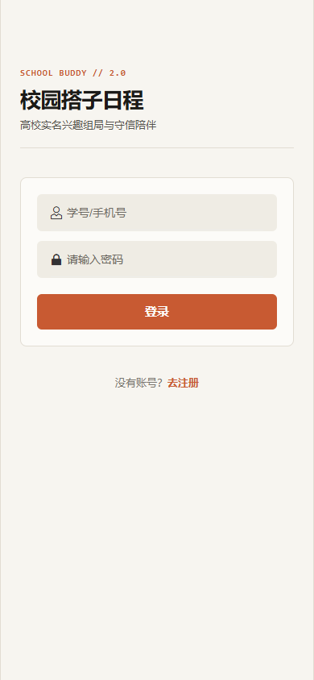
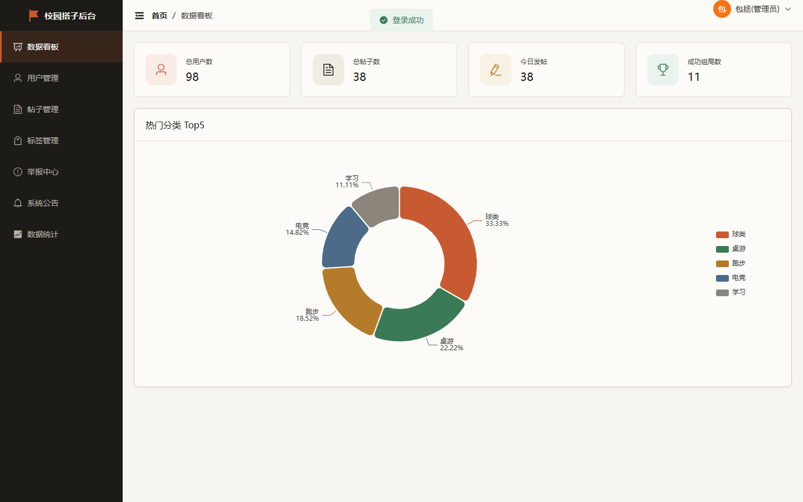

# 校园兴趣搭子预约系统 2.0（AI 智能版）

<p align="left">
  
  
  
  
  
</p>

一个面向高校学生的**实名高信任度兴趣搭子组局平台**。全新 2.0 版本采用克制耐看的 **「暖砂纸本 · 编辑级流式排版（Warm Editorial）」** 双端统一设计，深度融合 **AI 智能成局 / 破冰 / 风险研判** 与 **4 位数字现场签到码** 防爽约闭环，并内置 **98 位各行业名人演示账号** 与 **Windows 双击一键启动脚本**。

---

## ✨ 核心亮点

- **暖砂纸本 · 编辑级双端 UI**：摒弃浮夸渐变与厚重卡片堆砌，以暖砂纸底 `#F7F5F0`、极细 `1px` 分割线与单一低饱和陶土赭石 `#C85A32` 强调色统一 H5 学生端与桌面管理后台；组局广场采用去卡片化的流式日程排版，左侧等宽 `03/04` 席位锚点一眼扫清余位。
- **AI 原生组局与治理闭环**：
  - **AI 一键写帖 & 文案润色**：输入一句自然语言（如“周六下午4点东区篮球场3v3缺2个熟手”），自动解析分类、时间、地点、人数、段位并一键填表。
  - **AI 破冰小秘书**：报名通过互换联系方式后，结合双方兴趣标签自动生成高情商破冰话题与开场白。
  - **管理端 AI 举报风险研判**：结合 DFA 前缀树敏感词引擎与规则风险画像，自动输出举报置信度、违规特征与处置建议。
- **可解释推荐与防爽约履约闭环**：
  - 广场顶部提供「为你挑选的同频组局」推荐带，展示匹配度与具体推荐理由（如兴趣重合、同院、高信誉）。
  - 活动开始自动生成 **4 位数字现场签到码**，参与者到场自助核验出勤；无故爽约或临场退坑自动扣减信誉分，信誉分低于 60 分触发发帖/报名拦截。
- **零外部 Redis 强依赖 + 146 例单元测试**：登录锁定、浏览去重、限流与举报去重默认基于 MySQL `aux_kv` 表实现（也可一行配置无缝切换 Redis）；核心状态机、信誉分重算、候补递推、DFA 敏感词与 AI 模块均配有完整单元测试（`146/146` 通过）。

---

## 🖼️ 界面预览（暖砂纸本 Warm Editorial）

| H5 学生端 · 流式组局日程（390×844） | H5 学生端 · 登录页（390×844） |
| :---: | :---: |
|  |  |

**桌面管理后台 · 数据看板（1440×900）**



---

## ⚡ Windows 一键启动（推荐）

首次克隆后，只需配置好 `backend-v2/src/main/resources/application-local.yml`（见下方第三节），直接双击项目根目录的：

```text
一键启动项目.bat
```

脚本会自动完成以下全部流程：
1. **全量环境体检**：自动检测 **JDK 17**、**Maven**、**Node.js / npm**、**MySQL 客户端与 3306 服务连接**，缺少任一环境直接明确报错并暂停提示；
2. **自动导入 98 位名人测试数据（UTF-8 无乱码）**：按序导入 `init-all.sql`、`more-users.sql`、`demo-posts.sql`，所有招募中/进行中组局均采用相对当前时间（`NOW() + INTERVAL`），任何时候打开广场都有热招组局与进行中签到码；
3. **自动在桌面生成账号密码文档**：在桌面创建 `校园搭子系统-测试账号密码清单.md / .txt`，方便随时查阅登录；
4. **一键拉起三端服务窗口**：自动安装缺失的前端依赖，并分别启动后端（`8080`）、H5 用户端（`3000`）与管理端后台（`3001`）。

---

## 一、系统架构与模块组成

| 模块 | 技术栈 | 默认端口 | 说明 |
|------|--------|---------|------|
| `backend-v2/` | Java 17 + Spring Boot 3.3.5 + MyBatis-Plus | **8080** | 当前主力后端（含 146 例单元测试） |
| `frontend-h5/` | Vue 3 + Vite + Vant 4 + Pinia | **3000** | 学生移动端 H5（暖砂纸本流式日程风格） |
| `frontend-admin/` | Vue 3 + Vite + Element Plus + ECharts | **3001** | 管理员桌面后台（看板、巡检、AI 举报研判） |
| `database/` | MySQL 8.0+ | **3306** | 13 张表结构 + 98 位名人账号 + 38 条演示组局帖 |
| `scripts/` + `.bat` | PowerShell + Batch | — | Windows 一键环境检测、数据导入与三端启动脚本 |
| `backend-legacy/` | Java 8 + Spring Boot 2.7 | — | 历史归档版本（仅供追溯，勿启动） |

> 默认**无需安装 Redis**（辅助键值存储走 MySQL `aux_kv` 表，需要时可一键切回 Redis，见第五节）。

---

## 二、环境依赖要求

| 软件 | 推荐版本 | 检查命令 |
|------|---------|---------|
| **JDK** | **17（LTS，必须）** | `java -version` |
| **Maven** | 3.8+ | `mvn -version` |
| **MySQL** | 8.0+ | `mysql --version` |
| **Node.js / npm** | Node 18+（含 npm） | `node -v && npm -v` |
| Redis | 可选（5.0+） | 默认不需要，见第五节 |

---

## 三、本地敏感配置（首次启动必做）

项目不把数据库密码和 JWT 密钥提交进仓库，请先创建本地配置文件：

1. 进入 `backend-v2/src/main/resources/`
2. 复制 `application-local.example.yml` 并重命名为 `application-local.yml`
3. 填写你的本地 MySQL 密码与 32 位以上随机 JWT 密钥：
   ```yaml
   spring:
     datasource:
       password: 你的MySQL密码

   jwt:
     secret: 请填写至少32位长度的随机字母数字密钥字符串
   ```
> `application-local.yml` 已加入 `.gitignore`，不会被 Git 提交。

---

## 四、手动导入数据库与启动（macOS / Linux 或手动方式）

> Windows 用户直接双击 `一键启动项目.bat` 即可跳过本节。

### 1. 导入内置名人测试数据（必须带 `utf8mb4` 字符集）
```bash
mysql -u root -p --default-character-set=utf8mb4 < database/init-all.sql
mysql -u root -p --default-character-set=utf8mb4 school_buddy < database/more-users.sql
mysql -u root -p --default-character-set=utf8mb4 school_buddy < database/demo-posts.sql
```
> 也可在 Navicat 中右键连接选择「运行 SQL 文件」依次执行上述三个脚本。`init-all.sql` 已全部采用相对时间（`NOW() + INTERVAL`），并预置了系统公告、进行中 4 位签到码（如 `8848`、`6688`、`2026`）与待处理举报演示数据。

### 2. 启动后端（8080）
```bash
cd backend-v2
mvn spring-boot:run
# 运行全部 146 例单元测试：mvn test
```

### 3. 启动 H5 与管理后台
```bash
# H5 用户端 (http://localhost:3000)
cd frontend-h5 && npm install && npm run dev

# 管理端后台 (http://localhost:3001)
cd frontend-admin && npm install && npm run dev
```

---

## 五、辅助数据存储（默认 MySQL，无需 Redis）

登录失败锁定、浏览去重、接口限频与举报去重默认存储在 MySQL `aux_kv` 表中，零外部组件依赖。若需切换为 Redis：
1. 启动本地或局域网 Redis；
2. 在 `backend-v2/src/main/resources/application-local.yml` 中增加 `app.aux.store: redis`；
3. 重启后端即可无痛切换，业务代码零改动。

---

## 六、访问地址与名人演示账号速查

| 入口 | 访问地址 |
|------|---------|
| **H5 学生端** | http://localhost:3000 |
| **管理端后台** | http://localhost:3001 |
| **后端 API** | http://localhost:8080 |

完整 **98 位各界名人测试账号** 清单见 [`docs/测试用户清单.md`](docs/测试用户清单.md)（双击 `一键启动项目.bat` 也会自动输出到桌面）：

| 角色 / 演示场景 | 登录账号 | 登录密码 | 名人昵称 | 说明 |
|----------------|---------|---------|---------|------|
| **管理员（后台）** | `admin001` | `123456` | **包拯(管理员)** | 登录 `http://localhost:3001`，体验看板、AI 举报风险研判 |
| **快捷学生号（体育界）** | `20240001` | `123456` | **姚明** | 篮球(宗师)、王者荣耀(熟手)、晨跑(熟手) |
| **快捷学生号（体育界）** | `20240002` | `123456` | **谷爱凌** | 羽毛球(宗师)、剧本杀(高手)、夜跑(高手) |
| **科技与 AI 界** | `2342170101` | `2342170101123` | **雷军** | 发起《雷总带你打篮球3v3！交个朋友》 |
| **科技与 AI 界** | `2442170101` | `2442170101123` | **埃隆·马斯克** | 发起《东区篮球场 3v3 缺一人》 |
| **满员候补演示** | `2442170104` | `2442170104123` | **苏姿丰** | 发起《剧本杀《雾山》4人硬核本（3=1）》 |
| **4位签到码演示** | `2342170304` | `2342170304123` | **苏炳添** | 进行中《9秒83科学晨跑打卡》（签到码 `8848`） |
| **低信誉拦截演示** | `2442170309` | `2442170309123` | **法外狂徒张三** | 信誉分 `58` 分（演示低于 60 分风控拦截） |
| **低信誉拦截演示** | `2442170409` | `2442170409123` | **鸽王周幽王** | 信誉分 `45` 分（烽火戏诸侯放鸽子鼻祖） |

---

## 七、项目结构与文档索引

```text
school-buddy-system/
├─ 一键启动项目.bat     # Windows 双击一键环境检测 + 导入名人数据 + 生成桌面账号表 + 三端启动
├─ scripts/            # 启动脚本逻辑 (start-project.ps1)
├─ backend-v2/         # Spring Boot 3.3.5 后端（Java 17，端口 8080，146 例单测）
├─ frontend-h5/        # H5 学生端（Vue 3 + Vant 4，暖砂纸本 UI，端口 3000）
├─ frontend-admin/     # 桌面管理后台（Vue 3 + Element Plus + ECharts，端口 3001）
├─ database/           # init-all.sql / more-users.sql / demo-posts.sql（共 98 名人账号）
├─ docs/               # 完整项目文档与效果截图
└─ backend-legacy/     # 老版后端归档（Java 8 + Boot 2.7，仅供追溯）
```

| 文档路径 | 内容简介 |
|---------|---------|
| [`docs/产品需求文档（PRD）.md`](docs/产品需求文档（PRD）.md) | 业务背景、需求定义、状态机与信誉规则 |
| [`docs/功能与技术详解.md`](docs/功能与技术详解.md) | 技术架构、核心模块与深水区设计详解 |
| [`docs/项目优化与重新规划方案.md`](docs/项目优化与重新规划方案.md) | 2.0 全面体检报告与四阶段优化规划 |
| [`docs/重构优化与AI升级交付总结.md`](docs/重构优化与AI升级交付总结.md) | 缺陷修复、性能优化、AI 能力与测试验证总结 |
| [`docs/测试用户清单.md`](docs/测试用户清单.md) | 全部 98 位名人测试账号、密码、标签与演示剧本 |
| [`docs/项目使用文档.md`](docs/项目使用文档.md) | 详细操作指南与 FAQ |
| [`docs/答辩问答准备.md`](docs/答辩问答准备.md) | 答辩高频问答与现场演示脚本 |
