# 校园兴趣搭子预约系统 - 研发系统设计文档

| 文档属性 | 内容 |
|---------|------|
| 项目名称 | 校园兴趣搭子预约系统（School Buddy） |
| 文档版本 | V1.0 |
| 编写日期 | 2026-06-21 |
| 技术架构 | Spring Boot 单体后端 + Vue3 H5 用户端 + Vue3 PC 管理端 |

---

## 一、系统架构设计

### 1.1 系统总体架构

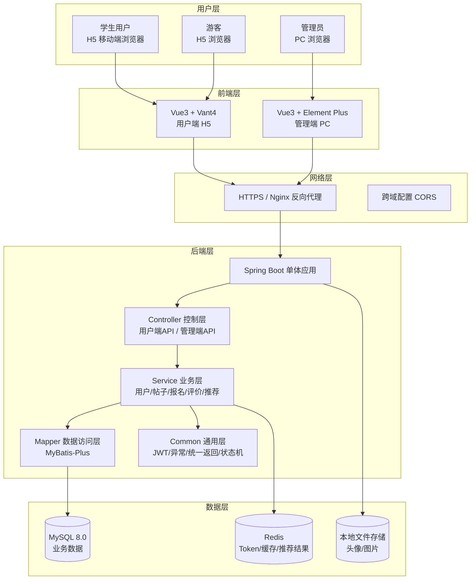

### 1.2 技术选型

| 层级 | 技术 | 版本 | 选型理由 |
|------|------|------|---------|
| 后端框架 | Spring Boot | 2.7.x | 成熟稳定，生态丰富，适合单体项目 |
| ORM 框架 | MyBatis-Plus | 3.5.x | 自动 CRUD + 代码生成器，极大提升开发效率 |
| 数据库 | MySQL | 8.0+ | 关系型数据库，支持复杂查询 |
| 缓存 | Redis | 7.x | 存 Token、推荐结果缓存、防重复提交 |
| 认证 | JWT + Spring Security | - | 无状态认证，前后端分离标准方案 |
| 密码加密 | BCrypt | - | 不可逆加密，安全性高 |
| 用户端 UI | Vue3 + Vant4 | 3.x / 4.x | 移动端 H5 最成熟的组件库 |
| 管理端 UI | Vue3 + Element Plus | 3.x | PC 后台管理最成熟的组件库 |
| 构建工具 | Vite | 4.x | 极速热更新，开发体验好 |
| 状态管理 | Pinia | 2.x | Vue3 官方推荐，轻量简洁 |
| HTTP 客户端 | Axios | 1.x | 请求拦截、统一错误处理 |
| 图表库 | ECharts | 5.x | 管理端数据统计可视化 |

### 1.3 系统分层架构

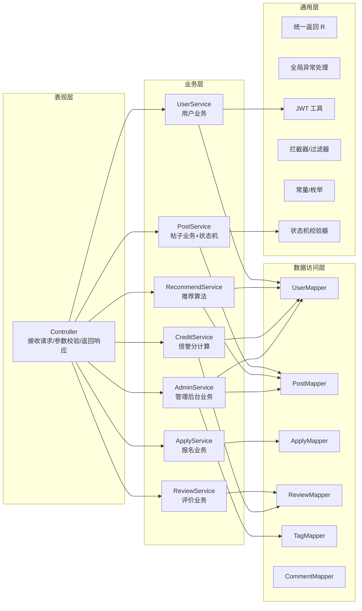

---

## 二、用例图

### 2.1 学生用户用例图

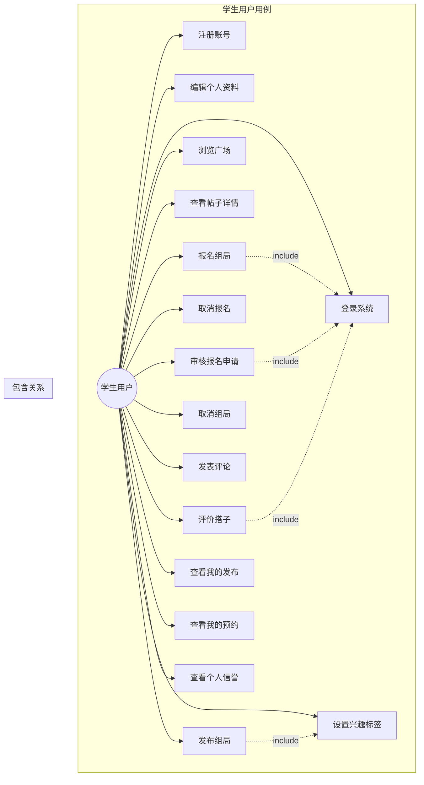

### 2.2 管理员用例图

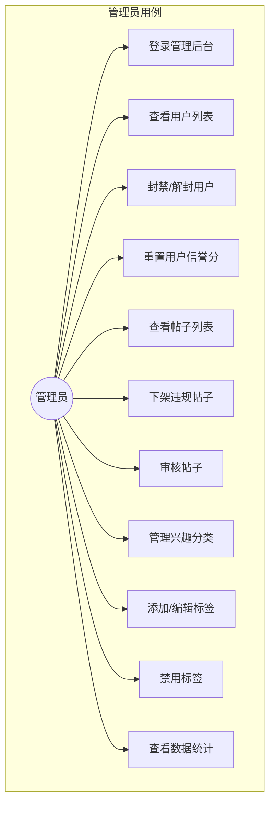

### 2.3 游客用例图

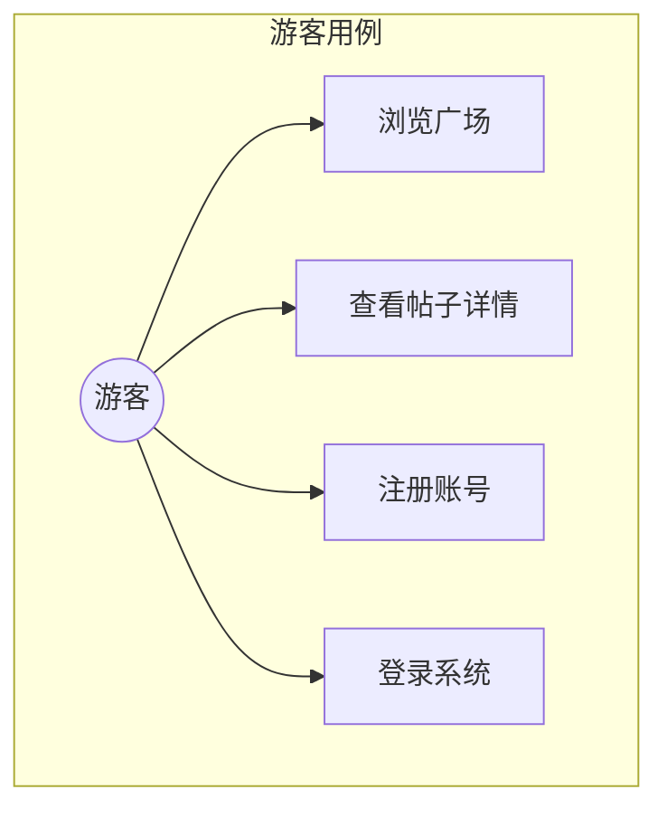

---

## 三、系统建模

### 3.1 领域模型（类图）

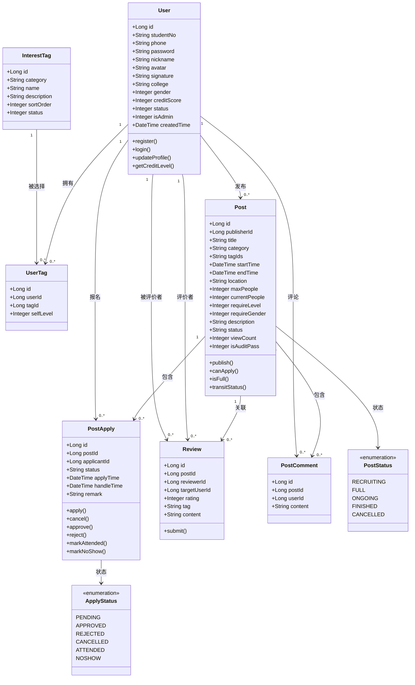

### 3.2 状态机模型

#### 3.2.1 帖子状态机

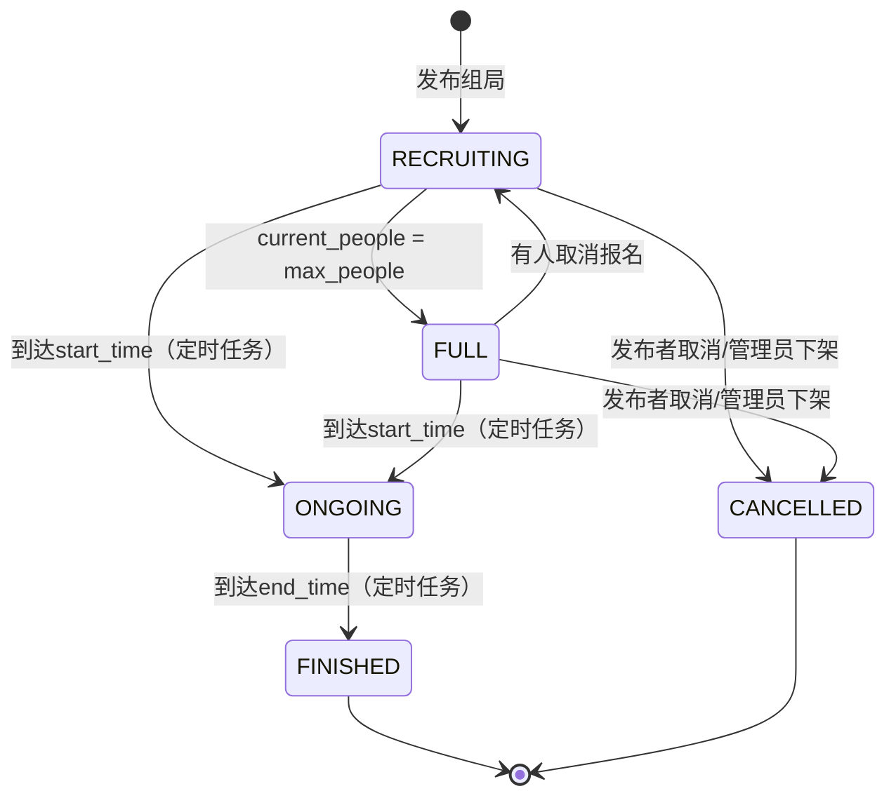

#### 3.2.2 报名状态机

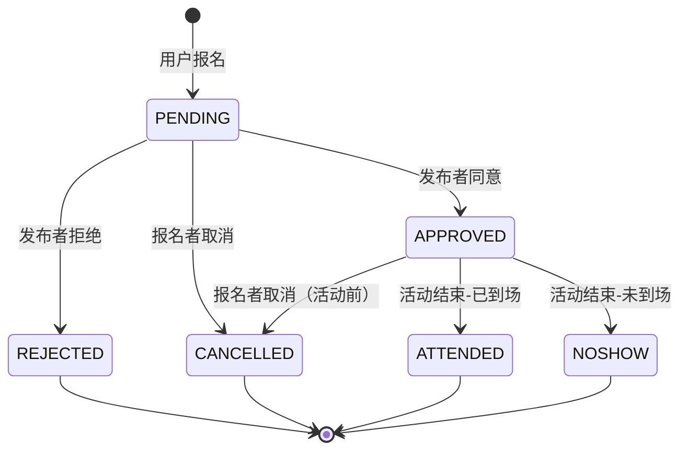

### 3.3 信誉分计算模型

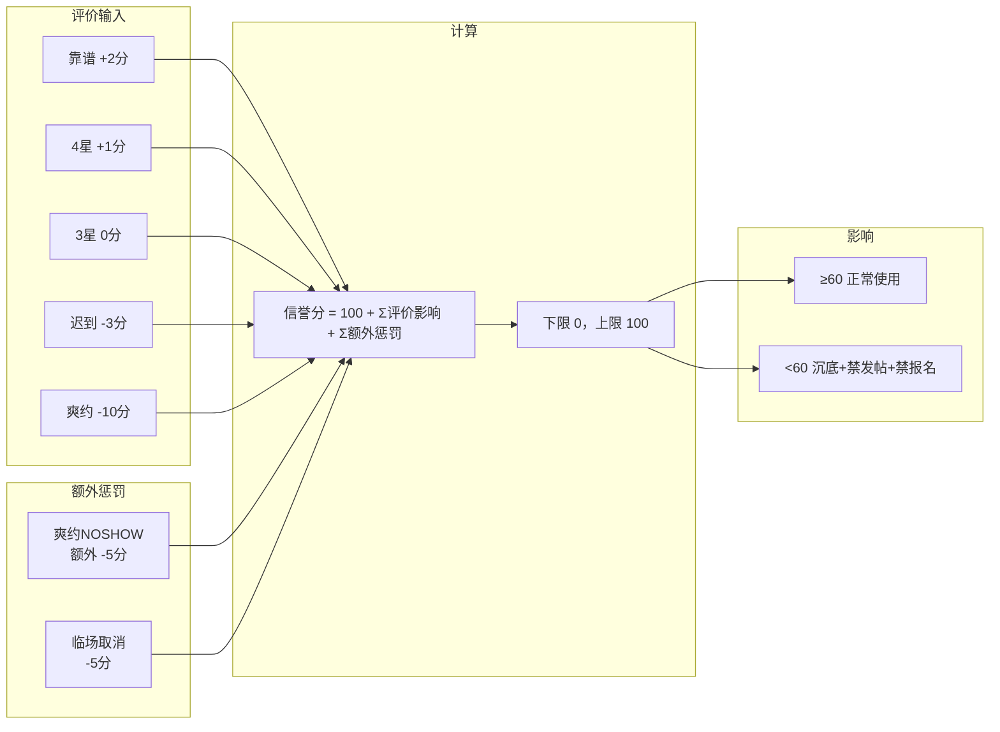

---

## 四、工程模式

### 4.1 后端工程目录结构

```
backend/
├── pom.xml
├── src/main/java/com/buddy/
│   ├── BuddyApplication.java              启动类
│   │
│   ├── config/                            配置层
│   │   ├── WebMvcConfig.java              跨域+拦截器配置
│   │   ├── SecurityConfig.java            Spring Security 配置
│   │   ├── MybatisPlusConfig.java         分页插件等配置
│   │   └── RedisConfig.java               Redis 配置
│   │
│   ├── common/                            通用层
│   │   ├── result/
│   │   │   ├── R.java                     统一返回结果
│   │   │   └── ResultCode.java            返回码枚举
│   │   ├── exception/
│   │   │   ├── BusinessException.java     业务异常
│   │   │   └── GlobalExceptionHandler.java 全局异常处理
│   │   ├── constant/
│   │   │   ├── PostStatus.java            帖子状态常量
│   │   │   ├── ApplyStatus.java           报名状态常量
│   │   │   └── CreditConstant.java        信誉分常量
│   │   ├── jwt/
│   │   │   ├── JwtUtils.java              JWT 生成/解析
│   │   │   └── JwtInterceptor.java        JWT 拦截器
│   │   └── statemachine/
│   │       └── PostStateMachine.java      帖子状态机校验器
│   │
│   ├── controller/
│   │   ├── user/                          用户端接口
│   │   │   ├── AuthController.java        注册/登录
│   │   │   ├── UserController.java        个人资料/标签
│   │   │   ├── PostController.java        帖子相关
│   │   │   ├── ApplyController.java       报名相关
│   │   │   ├── ReviewController.java      评价相关
│   │   │   └── SquareController.java      广场+推荐
│   │   └── admin/                         管理端接口
│   │       ├── AdminUserController.java   用户管理
│   │       ├── AdminPostController.java   帖子管理
│   │       ├── AdminTagController.java    标签管理
│   │       └── AdminStatsController.java  数据统计
│   │
│   ├── service/
│   │   ├── UserService.java
│   │   ├── PostService.java               含状态流转逻辑
│   │   ├── ApplyService.java              含报名校验逻辑
│   │   ├── ReviewService.java
│   │   ├── RecommendService.java          推荐算法
│   │   ├── CreditService.java             信誉分计算
│   │   ├── TagService.java
│   │   ├── CommentService.java
│   │   ├── AdminService.java
│   │   ├── StatsService.java              数据统计
│   │   └── impl/                          服务实现类
│   │
│   ├── mapper/
│   │   ├── UserMapper.java
│   │   ├── PostMapper.java
│   │   ├── PostApplyMapper.java
│   │   ├── ReviewMapper.java
│   │   ├── InterestTagMapper.java
│   │   ├── UserTagMapper.java
│   │   └── PostCommentMapper.java
│   │
│   ├── entity/                            数据库实体
│   │   ├── User.java
│   │   ├── Post.java
│   │   ├── PostApply.java
│   │   ├── Review.java
│   │   ├── InterestTag.java
│   │   ├── UserTag.java
│   │   └── PostComment.java
│   │
│   ├── dto/                               数据传输对象
│   │   ├── request/                       请求 DTO
│   │   │   ├── RegisterRequest.java
│   │   │   ├── LoginRequest.java
│   │   │   ├── ProfileUpdateRequest.java
│   │   │   ├── PostCreateRequest.java
│   │   │   ├── ApplyRequest.java
│   │   │   └── ReviewRequest.java
│   │   └── response/                      响应 DTO
│   │       ├── UserVO.java
│   │       ├── PostVO.java
│   │       ├── PostDetailVO.java
│   │       └── StatsVO.java
│   │
│   └── task/
│       ├── PostStatusTask.java            帖子状态定时任务
│       └── CreditCalculateTask.java       信誉分计算定时任务
│
└── src/main/resources/
    ├── application.yml
    ├── application-dev.yml
    └── mapper/                            MyBatis XML（复杂SQL）
```

### 4.2 前端 H5 工程目录结构

```
frontend-h5/
├── package.json
├── vite.config.js
├── index.html
├── src/
│   ├── main.js                            入口
│   ├── App.vue
│   │
│   ├── api/                               API 封装
│   │   ├── request.js                     axios 实例+拦截器
│   │   ├── auth.js                        注册/登录接口
│   │   ├── user.js                        用户相关接口
│   │   ├── post.js                        帖子相关接口
│   │   ├── apply.js                       报名相关接口
│   │   └── review.js                      评价相关接口
│   │
│   ├── router/                            路由
│   │   └── index.js                       路由配置+守卫
│   │
│   ├── store/                             Pinia 状态管理
│   │   ├── user.js                        用户状态
│   │   └── tag.js                         标签状态
│   │
│   ├── views/                             页面
│   │   ├── auth/
│   │   │   ├── Login.vue                  登录页
│   │   │   └── Register.vue               注册页
│   │   ├── square/
│   │   │   └── Square.vue                 广场页（首页）
│   │   ├── post/
│   │   │   ├── PostDetail.vue             帖子详情
│   │   │   └── PostCreate.vue             发布组局
│   │   ├── mine/
│   │   │   ├── Profile.vue                个人资料
│   │   │   ├── MyPosts.vue                我的发布
│   │   │   ├── MyApplies.vue              我的预约
│   │   │   └── TagSetting.vue             兴趣标签设置
│   │   └── review/
│   │       └── ReviewPage.vue             评价页
│   │
│   ├── components/                        公共组件
│   │   ├── PostCard.vue                   帖子卡片
│   │   ├── CreditStar.vue                 信誉星级
│   │   ├── TagBadge.vue                   标签徽章
│   │   ├── EmptyState.vue                 空状态
│   │   └── Loading.vue                    加载动画
│   │
│   ├── styles/                            样式
│   │   ├── variables.scss                 变量
│   │   └── global.scss                    全局样式
│   │
│   └── utils/                             工具
│       ├── format.js                      格式化工具
│       └── validate.js                    校验工具
```

### 4.3 前端 PC 管理端工程目录结构

```
frontend-admin/
├── package.json
├── vite.config.js
├── index.html
├── src/
│   ├── main.js
│   ├── App.vue
│   │
│   ├── api/
│   │   ├── request.js
│   │   ├── admin.js                       管理端接口
│   │   └── stats.js                       统计接口
│   │
│   ├── router/
│   │   └── index.js
│   │
│   ├── store/
│   │   └── admin.js
│   │
│   ├── layout/                            布局
│   │   ├── Layout.vue                     主布局
│   │   ├── Sidebar.vue                    侧边栏
│   │   └── Header.vue                     顶栏
│   │
│   ├── views/
│   │   ├── Login.vue                      管理员登录
│   │   ├── dashboard/
│   │   │   └── Index.vue                  数据看板
│   │   ├── user/
│   │   │   └── UserList.vue               用户管理
│   │   ├── post/
│   │   │   ├── PostList.vue               帖子管理
│   │   │   └── PostAudit.vue              帖子审核
│   │   ├── tag/
│   │   │   └── TagManage.vue              标签管理
│   │   └── stats/
│   │       └── StatsView.vue              数据统计
│   │
│   └── components/
│       └── charts/                        ECharts 图表组件
│           ├── LineChart.vue
│           ├── PieChart.vue
│           └── BarChart.vue
```

### 4.4 设计模式应用

| 设计模式 | 应用场景 | 说明 |
|---------|---------|------|
| MVC 模式 | 整体架构 | Controller-Service-Mapper 三层分离 |
| 策略模式 | 推荐排序 | 不同排序策略（推荐/最新/热度）可切换 |
| 状态机模式 | 帖子状态流转 | PostStateMachine 封装状态流转校验 |
| 拦截器模式 | JWT 认证 | JwtInterceptor 统一处理登录校验 |
| 统一返回模式 | API 响应 | R<T> 统一封装返回结构 |
| 全局异常处理 | 错误处理 | @ControllerAdvice 统一捕获异常 |
| DTO 模式 | 数据传输 | Request/Response DTO 与 Entity 分离 |
| 建造者模式 | 复杂查询 | MyBatis-Plus QueryWrapper 链式构建 |

---

## 五、功能流程

### 5.1 用户注册登录流程

```mermaid
flowchart TD
    A[开始] --> B{选择注册方式}
    B -->|学号注册| C[输入学号+密码+姓名]
    B -->|手机号注册| D[输入手机号+密码+姓名]

    C --> E[前端校验格式]
    D --> E
    E --> F{校验通过?}
    F -->|否| G[提示错误信息]
    G --> E
    F -->|是| H[提交注册请求]

    H --> I[后端校验学号/手机号是否已存在]
    I --> J{已存在?}
    J -->|是| K[返回"账号已注册"]
    J -->|否| L[BCrypt 加密密码]

    L --> M[写入 sys_user 表<br/>credit_score=100]
    M --> N[注册成功]

    N --> O[跳转登录页]
    O --> P[输入账号+密码]
    P --> Q[后端校验账号密码]
    Q --> R{校验通过?}
    R -->|否| S[提示"账号或密码错误"]
    R -->|是| T[生成 JWT Token]
    T --> U[返回 Token + 用户信息]
    U --> V[前端存储 Token]
    V --> W[跳转首页]
```

### 5.2 发布组局流程

```mermaid
flowchart TD
    A[用户点击"发布组局"] --> B{是否登录?}
    B -->|否| C[跳转登录页]
    B -->|是| D{信誉分 >= 60?}

    D -->|否| E[提示"信誉分过低，无法发布"]
    D -->|是| F[填写组局表单]

    F --> G[选择兴趣分类]
    G --> H[选择具体项目]
    H --> I[设置时间/地点/人数]
    I --> J[设置段位/性别要求]
    J --> K[填写描述]
    K --> L[前端校验]

    L --> M{校验通过?}
    M -->|否| N[提示错误]
    N --> F
    M -->|是| O[提交后端]

    O --> P[后端二次校验]
    P --> Q{校验通过?}
    Q -->|否| R[返回错误信息]
    Q -->|是| S[写入 post 表<br/>status=RECRUITING<br/>current_people=1]

    S --> T[发布成功]
    T --> U[跳转帖子详情]
```

### 5.3 报名与审核流程

```mermaid
flowchart TD
    A[用户浏览广场] --> B[点击帖子详情]
    B --> C{帖子状态?}

    C -->|非招募中| D[提示"无法报名"]
    C -->|招募中| E{是否已报名?}

    E -->|是| F[显示"已报名"]
    E -->|否| G{信誉分 >= 60?}

    G -->|否| H[提示"信誉分过低"]
    G -->|是| I{满足段位/性别要求?}

    I -->|否| J[提示"不满足要求"]
    I -->|是| K[点击"报名"]

    K --> L[写入 post_apply<br/>status=PENDING]
    L --> M[通知发布者]

    M --> N[发布者查看报名列表]
    N --> O{审核决定}

    O -->|同意| P[post_apply.status=APPROVED<br/>post.current_people+1]
    O -->|拒绝| Q[post_apply.status=REJECTED]

    P --> R{current_people = max_people?}
    R -->|是| S[post.status=FULL]
    R -->|否| T[保持 RECRUITING]

    Q --> U[通知报名者被拒绝]
```

### 5.4 帖子状态自动流转流程（定时任务）

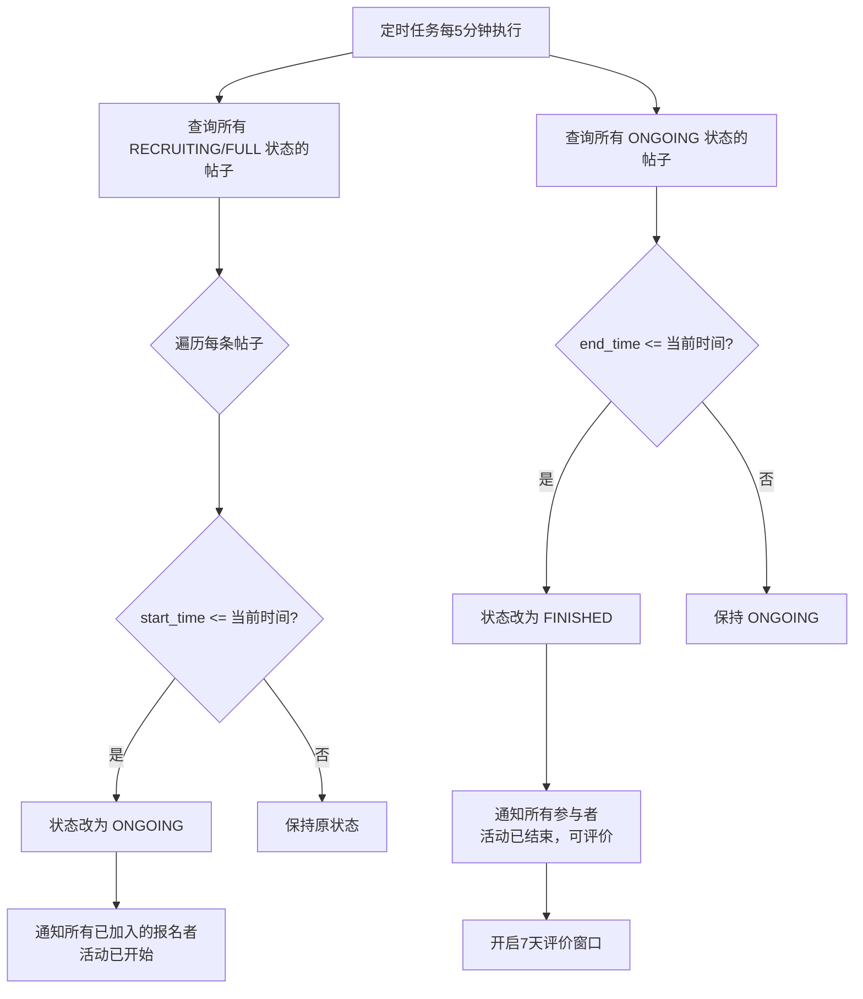

### 5.5 评价与信誉分更新流程

```mermaid
flowchart TD
    A[活动结束 FINISHED] --> B[7天评价窗口开启]

    B --> C[用户进入评价页]
    C --> D{是否已评价?}

    D -->|是| E[显示"已评价"]
    D -->|否| F[选择星级+标签+文字]

    F --> G[提交评价]
    G --> H[写入 review 表]

    H --> I{是否双方都已评价?}
    I -->|否| J[等待对方评价]
    I -->|是| K[触发信誉分重新计算]

    K --> L[定时任务每日凌晨执行]
    L --> M[查询用户所有收到的评价]
    M --> N[计算: 信誉分 = 100 + Σ评价影响]

    N --> O{信誉分 < 0?}
    O -->|是| P[信誉分 = 0]
    O -->|否| Q{信誉分 > 100?}

    Q -->|是| R[信誉分 = 100]
    Q -->|否| S[更新 sys_user.credit_score]

    P --> S
    R --> S

    S --> T{信誉分 < 60?}
    T -->|是| U[触发失信惩罚<br/>沉底+禁发帖+禁报名]
    T -->|否| V[正常使用]
```

### 5.6 推荐算法流程

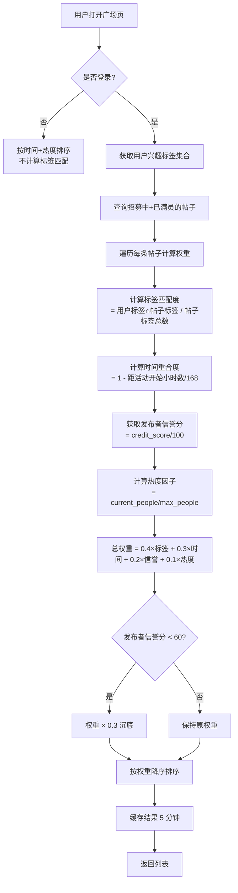

---

## 六、UML 时序图

### 6.1 用户注册登录时序图

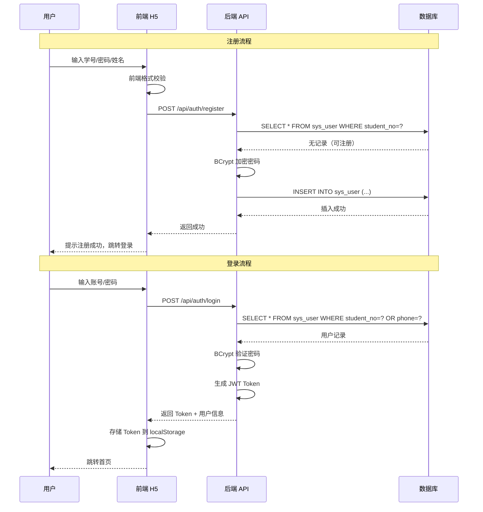

### 6.2 发布组局时序图

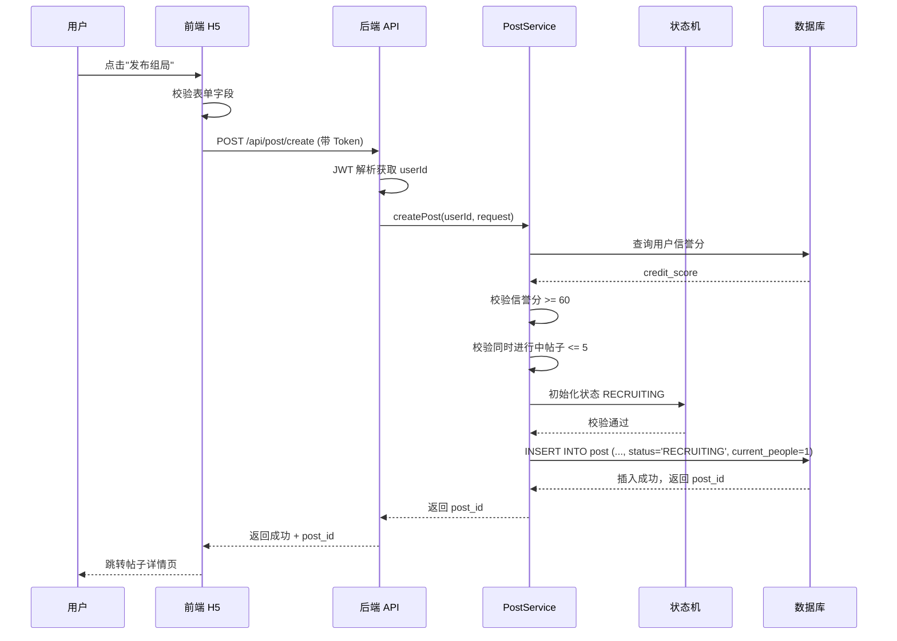

### 6.3 报名与审核时序图

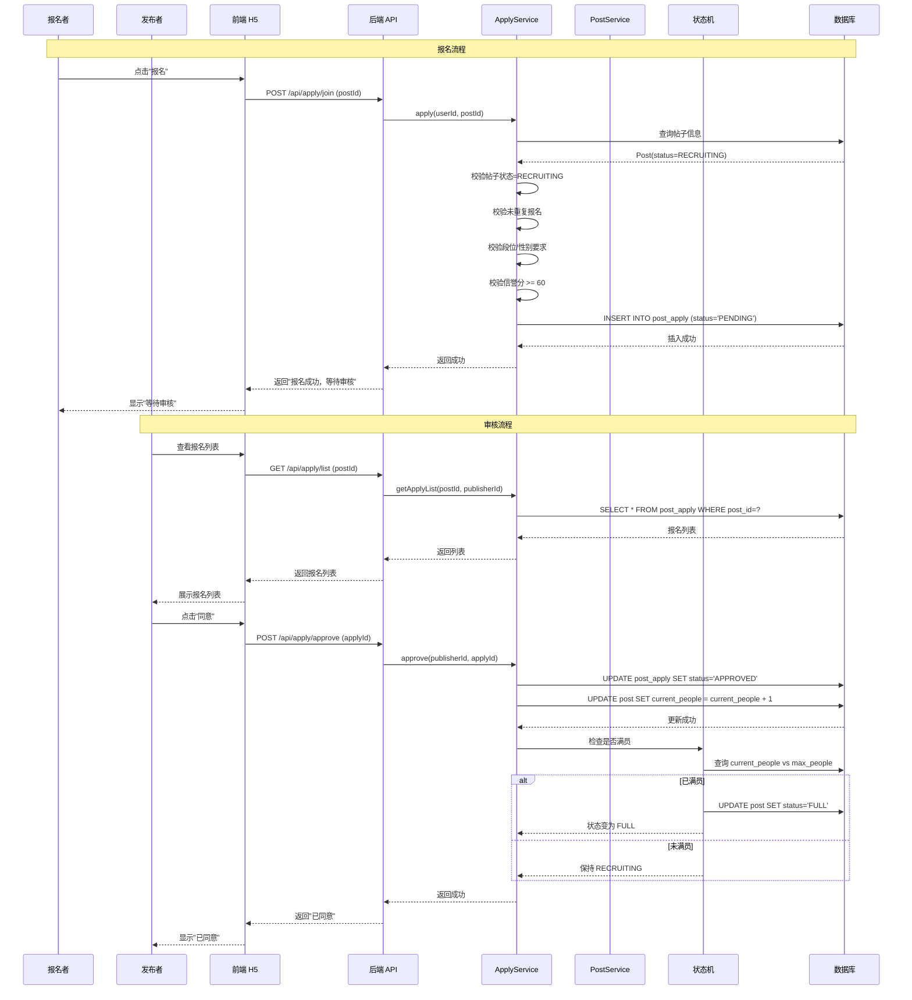

### 6.4 帖子状态自动流转时序图

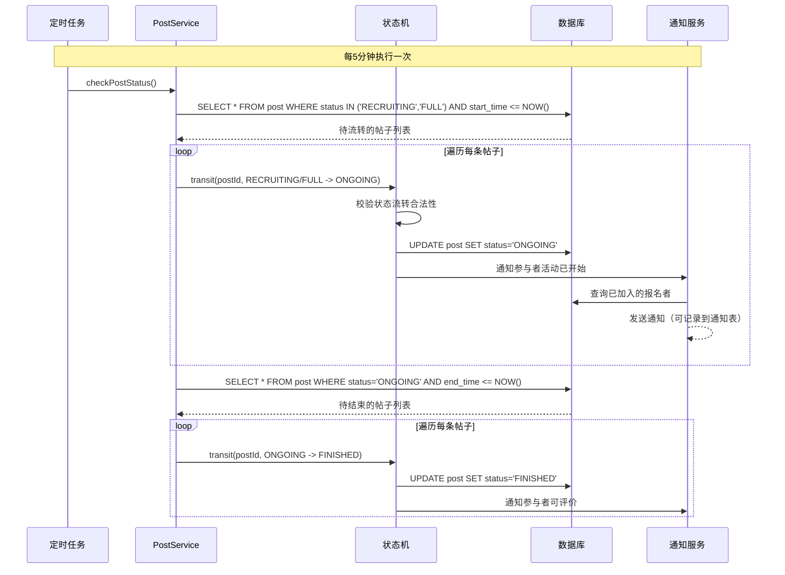

### 6.5 评价与信誉分更新时序图

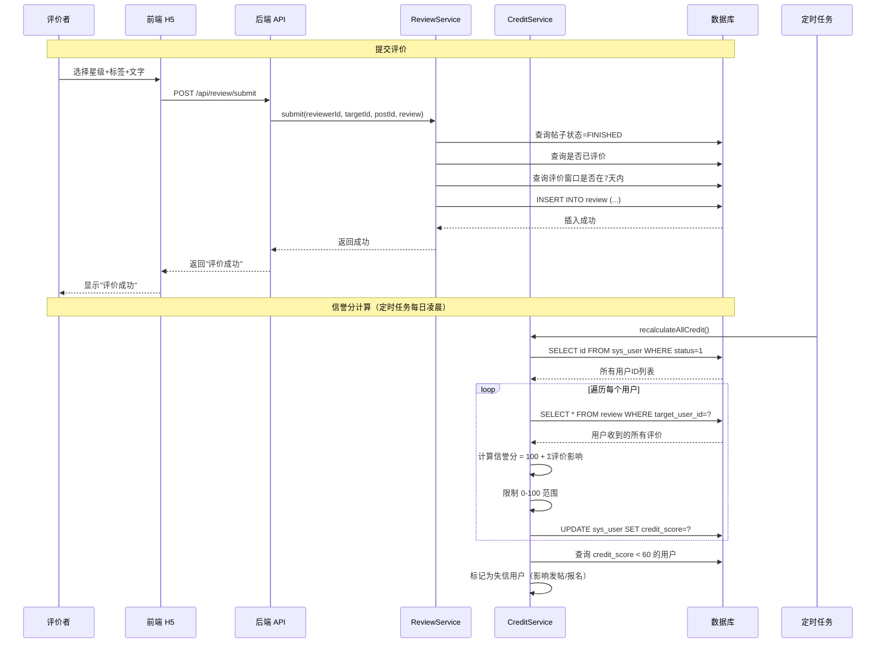

### 6.6 推荐算法时序图

```mermaid
sequenceDiagram
    participant U as 用户
    participant F as 前端 H5
    participant B as 后端 API
    participant RS as RecommendService
    participant Cache as Redis 缓存
    participant DB as 数据库

    U->>F: 打开广场页
    F->>B: GET /api/square/list?page=1&sort=recommend

    B->>RS: getRecommendList(userId, page, sort)

    RS->>Cache: 查询缓存 key=recommend:{userId}:{page}

    alt 缓存命中
        Cache-->>RS: 返回缓存结果
        RS-->>B: 返回列表
    else 缓存未命中
        RS->>DB: 查询用户兴趣标签
        DB-->>RS: 用户标签集合

        RS->>DB: 查询招募中+已满员的帖子
        DB-->>RS: 帖子列表

        loop 遍历每条帖子
            RS->>RS: 计算标签匹配度
            RS->>RS: 计算时间重合度
            RS->>DB: 查询发布者信誉分
            DB-->>RS: credit_score
            RS->>RS: 计算热度因子
            RS->>RS: 总权重 = 0.4×标签 + 0.3×时间 + 0.2×信誉 + 0.1×热度
            RS->>RS: 若信誉分<60，权重×0.3
        end

        RS->>RS: 按权重降序排序
        RS->>RS: 分页截取
        RS->>Cache: 写入缓存，TTL=5分钟
        RS-->>B: 返回列表
    end

    B-->>F: 返回帖子列表
    F-->>U: 渲染广场列表
```

### 6.7 管理员审核流程时序图

```mermaid
sequenceDiagram
    participant A as 管理员
    participant F as 管理端 PC
    participant B as 后端 API
    participant AS as AdminService
    participant DB as 数据库

    Note over A,DB: 用户封禁流程
    A->>F: 查看用户列表
    F->>B: GET /api/admin/user/list
    B->>AS: getUserList(page, keyword)
    AS->>DB: SELECT * FROM sys_user WHERE ...
    DB-->>AS: 用户列表
    AS-->>B: 返回列表
    B-->>F: 返回用户列表
    F-->>A: 展示用户列表

    A->>F: 点击"封禁"
    F->>B: POST /api/admin/user/ban (userId)
    B->>AS: banUser(adminId, userId)
    AS->>DB: UPDATE sys_user SET status=0
    DB-->>AS: 更新成功
    AS-->>B: 返回成功
    B-->>F: 返回"已封禁"
    F-->>A: 显示"已封禁"

    Note over A,DB: 帖子下架流程
    A->>F: 查看帖子列表
    F->>B: GET /api/admin/post/list
    B->>AS: getPostList(page, filter)
    AS->>DB: SELECT * FROM post WHERE ...
    DB-->>AS: 帖子列表
    AS-->>B: 返回列表
    B-->>F: 返回帖子列表

    A->>F: 点击"下架"
    F->>B: POST /api/admin/post/takedown (postId)
    B->>AS: takedownPost(adminId, postId)
    AS->>DB: UPDATE post SET status='CANCELLED'
    DB-->>AS: 更新成功
    AS-->>B: 返回成功
    B-->>F: 返回"已下架"
    F-->>A: 显示"已下架"
```

---

## 七、接口设计概览

### 7.1 用户端接口

| 模块 | 接口 | 方法 | 说明 |
|------|------|------|------|
| 认证 | /api/auth/register | POST | 注册 |
| 认证 | /api/auth/login | POST | 登录 |
| 用户 | /api/user/profile | GET | 获取个人资料 |
| 用户 | /api/user/profile | PUT | 编辑个人资料 |
| 用户 | /api/user/tags | GET | 获取我的标签 |
| 用户 | /api/user/tags | PUT | 设置兴趣标签 |
| 用户 | /api/user/posts | GET | 我的发布 |
| 用户 | /api/user/applies | GET | 我的预约 |
| 帖子 | /api/post/create | POST | 发布组局 |
| 帖子 | /api/post/detail/{id} | GET | 帖子详情 |
| 帖子 | /api/post/cancel/{id} | POST | 取消组局 |
| 广场 | /api/square/list | GET | 广场列表（推荐） |
| 报名 | /api/apply/join | POST | 报名 |
| 报名 | /api/apply/cancel/{id} | POST | 取消报名 |
| 报名 | /api/apply/list/{postId} | GET | 报名列表 |
| 报名 | /api/apply/approve/{id} | POST | 同意报名 |
| 报名 | /api/apply/reject/{id} | POST | 拒绝报名 |
| 评价 | /api/review/submit | POST | 提交评价 |
| 评价 | /api/review/list/{postId} | GET | 评价列表 |
| 评论 | /api/comment/list/{postId} | GET | 评论列表 |
| 评论 | /api/comment/add | POST | 发表评论 |

### 7.2 管理端接口

| 模块 | 接口 | 方法 | 说明 |
|------|------|------|------|
| 认证 | /api/admin/login | POST | 管理员登录 |
| 用户 | /api/admin/user/list | GET | 用户列表 |
| 用户 | /api/admin/user/ban/{id} | POST | 封禁用户 |
| 用户 | /api/admin/user/unban/{id} | POST | 解封用户 |
| 用户 | /api/admin/user/credit | PUT | 重置信誉分 |
| 帖子 | /api/admin/post/list | GET | 帖子列表 |
| 帖子 | /api/admin/post/takedown/{id} | POST | 下架帖子 |
| 帖子 | /api/admin/post/audit/{id} | POST | 审核帖子 |
| 标签 | /api/admin/tag/list | GET | 标签列表 |
| 标签 | /api/admin/tag/add | POST | 添加标签 |
| 标签 | /api/admin/tag/update | PUT | 编辑标签 |
| 标签 | /api/admin/tag/disable/{id} | POST | 禁用标签 |
| 统计 | /api/admin/stats/overview | GET | 数据概览 |
| 统计 | /api/admin/stats/posts | GET | 发帖量趋势 |
| 统计 | /api/admin/stats/success | GET | 成功组局数 |
| 统计 | /api/admin/stats/active | GET | 活跃用户数 |
| 统计 | /api/admin/stats/category | GET | 热门分类 |
| 统计 | /api/admin/stats/credit | GET | 信誉分分布 |

---

## 八、统一返回格式

### 8.1 成功响应

```json
{
    "code": 200,
    "message": "success",
    "data": {
        "id": 1,
        "nickname": "小明",
        "creditScore": 95
    }
}
```

### 8.2 分页响应

```json
{
    "code": 200,
    "message": "success",
    "data": {
        "records": [...],
        "total": 100,
        "current": 1,
        "size": 10
    }
}
```

### 8.3 错误响应

```json
{
    "code": 400,
    "message": "学号已注册",
    "data": null
}
```

### 8.4 状态码定义

| 码值 | 说明 |
|------|------|
| 200 | 成功 |
| 400 | 参数错误/业务校验失败 |
| 401 | 未登录/Token失效 |
| 403 | 无权限 |
| 404 | 资源不存在 |
| 500 | 服务器内部错误 |

---

## 九、安全设计

### 9.1 认证与鉴权

```mermaid
flowchart LR
    A[前端请求] --> B[携带 JWT Token]
    B --> C[JwtInterceptor 拦截]
    C --> D{Token 有效?}
    D -->|否| E[返回 401 未登录]
    D -->|是| F[解析 userId 放入 ThreadLocal]
    F --> G{需要管理员权限?}
    G -->|是| H{is_admin=1?}
    H -->|否| I[返回 403 无权限]
    H -->|是| J[放行到 Controller]
    G -->|否| J
    J --> K[业务处理]
```

### 9.2 越权防护

| 场景 | 防护措施 |
|------|---------|
| 编辑他人帖子 | Controller 层校验 publisher_id = 当前 userId |
| 审核他人帖子的报名 | 校验 postId 对应的 publisher_id = 当前 userId |
| 封禁用户 | 校验 is_admin = 1 |
| 修改个人资料 | JWT 解析的 userId 必须与请求体的 userId 一致 |

---

## 十、部署架构

```mermaid
graph TB
    subgraph 开发环境
        D1[本地 MySQL 8.0]
        D2[本地 Redis]
        D3[Spring Boot DevTools]
        D4[Vite Dev Server]
    end

    subgraph 生产环境
        P1[Nginx<br/>反向代理+静态资源]
        P2[Spring Boot Jar<br/>8080端口]
        P3[(MySQL 8.0)]
        P4[(Redis)]
    end

    P1 -->|/api/*| P2
    P1 -->|/| 静态文件
    P2 --> P3
    P2 --> P4
```

**Nginx 配置要点**：

```nginx
# 用户端 H5
location / {
    root /usr/share/nginx/html/h5;
    try_files $uri $uri/ /index.html;
}

# 管理端 PC
location /admin {
    root /usr/share/nginx/html/admin;
    try_files $uri $uri/ /admin/index.html;
}

# 后端 API 代理
location /api/ {
    proxy_pass http://localhost:8080;
    proxy_set_header Host $host;
    proxy_set_header X-Real-IP $remote_addr;
}
```
